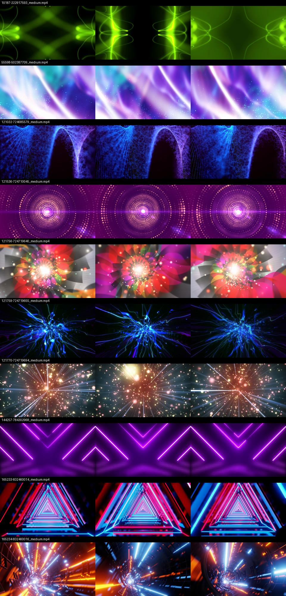

# Clip-based audio-responsive candidates

## Current owner decision — September 5

The owner rejected both procedural experiments and explicitly requested restoring
the uploaded clips. The original ten video assets, posters, decoder implementation,
and catalog routing are restored. Rejected experiments are preserved outside Android
source sets in `rejected-procedural-experiments/`; they are not active visualizers.
No other visualization is changed by this rollback.

The ten candidates are integrated additively in the native TV catalog. The replacement mapping
is a recommendation; none of the existing styles has been removed. Validation status is tracked
in [validation.md](validation.md).
The ten owner-supplied clips were inspected at 10%, 50%, and 90% of their duration.
Names below refer to the current working-tree catalog, including its existing changes.

| Source clip | Candidate | Recommended replacement | Distinctive audio response |
| --- | --- | --- | --- |
| 10187-222917593_medium.mp4 | Emerald Resonance | Mirror Script | Bass opens the mirrored green plasma; mids bend the filaments. |
| 55598-502387709_medium.mp4 | Aurora Veil | Chromafield | Broad, restrained bass breathing; treble lights the star dust. |
| 121032-724685579_medium.mp4 | Spectral Silk | Woven Current | Mids ripple the blue-violet particle curtains; bass controls scale and playback speed. |
| 121536-724710045_medium.mp4 | Orbital Pulse | Pulse Observatory | Bass expands the concentric dot rings; attacks illuminate the central aperture. |
| 121756-724719640_medium.mp4 | Chromatic Blossom | Psychedelic Scene | Bass opens the petals; midrange energy adjusts brightness and motion speed. |
| 121759-724719655_medium.mp4 | Electric Synapse | Echo Reef | Transients energize the branching blue filaments; bass expands the core. |
| 121770-724719694_medium.mp4 | Stardust Ignition | Orbit Bloom | Bass gives the radial particle field depth; treble raises the video surface brightness. |
| 144257-784302968_medium.mp4 | Violet Circuit | Vector Switchboard | Bass pushes the chevrons; mids create small horizontal refractions. |
| 165233-832460014_medium.mp4 | Prismatic Passage | Harmonic Gate | Bass expands the triangular passage; transients add a small expansion and lighting accent. |
| 165234-832460016_medium.mp4 | Ion Transit | Magnetic Fields | Bass drives the tunnel's scale; highs raise its brightness. |

## Recommendation

Prioritize Spectral Silk, Electric Synapse, Violet Circuit, and Prismatic Passage:
their sources provide fuller surfaces for currently sparse woven, branching, path,
and arch treatments. Aurora Veil adds the calmest option. Orbital Pulse and Stardust
Ignition overlap in radial composition; audition them together before retaining both.
Prismatic Passage and Ion Transit likewise need an in-motion comparison to justify
two forward-travel styles.

Preserve Neon Kaleidoscope, EQ Spectrum, Signal Deck, DJ Soff Snep, and Lava Lamp,
which the current roadmap marks as protected. Preserve Light Trails and the ongoing
Laser Light Show work. Existing persistence keys and ordinals must remain stable if
the owner selects replacements.

## Media and implementation boundaries

All sources are 16:9 H.264, approximately 7.5–29 seconds long. Eight are 2560×1440;
two are 1280×720. Their combined original storage is approximately 201 MB (decimal).
Three sources (121756, 121759, 121770) include AAC tracks that must be removed or
disabled. Station playback is the only audio authority.

A clip-based implementation makes the video surface respond to measured audio;
the motion already baked into the video is not itself a live spectrum measurement.
Silence must remove the added response. Native procedural recreation would allow
individual particles, petals, and geometry to follow the PCM directly, but would
be a reinterpretation rather than exact reproduction of the clips.

The native implementation uses bounded attack/release smoothing, fixed calibrated PCM
bands, and the existing reduced-intensity preference. Scale, shear (three styles),
brightness and video playback speed respond to the measured signal. Silence pauses
the video. Individual recorded particles and petals are not independently simulated.
The single selected video decoder releases on background/exit and retries once on
foreground re-entry after an error. The poster remains visible until a decoded frame
is ready. D-pad and Back remain owned by the existing Compose screens. Local possession of the files does not establish redistribution
terms; provenance is needed before bundling them in a distributed release.

The implementation follows Media3 [track-type disabling](https://developer.android.com/media/media3/exoplayer/track-selection) and [player lifecycle guidance](https://developer.android.com/media/media3/exoplayer/hello-world). No WebView or new dependency is introduced.
